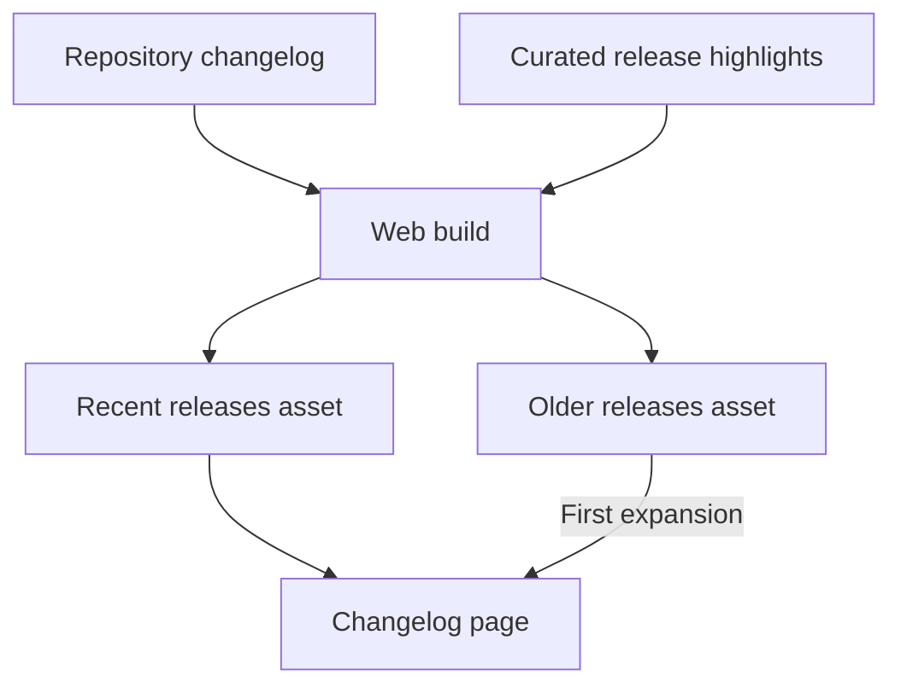

# Compact web changelog

- **Revision:** 1
- **Status:** approved on 2026-11-20 by Vitalii Kasap
- **Scope:** the public [Applye changelog](https://applye.dev/changelog/).

## Visitor experience

Today the page downloads the full repository changelog and renders all 44 version headings from
the local source, including `Unreleased`. The source is about 613 kB and contains long engineering
notes. The page also explains its own versioning and Markdown source.

The compact page has one heading, **Changelog**, and three recent release entries, newest first.
Each shows the version, date and up to three one-line highlights of at most 100 characters each.
Lead with changes a user will notice and keep any important upgrade instruction among the highlights.
Example copy grounded in the existing release notes:

| Version | Example highlight                            |
| ------- | -------------------------------------------- |
| 0.29.4  | Fixed a macOS launch failure.                |
| 0.29.3  | Fixed a dead end when skipping CV tailoring. |
| 0.29.2  | Check for and install updates from Settings. |

Below the recent entries, **Older releases** opens a collapsed archive and starts its first
request. Archive rows show the version, date and a link to the corresponding complete notes.
Each recent entry also links to its complete notes. Keep the existing **GitHub Releases** link
as a quieter secondary action. If there are fewer than four published entries, show only the
available recent entries and omit the archive control.

Use a native disclosure, a visible keyboard focus ring and the shared color, type and spacing
tokens. Use monospaced version labels, secondary-color dates and a ghost-style archive control.
The route copy follows the current English content locale. Store new fixed UI strings in
`libs/i18n` through its existing translation export.

## Build and runtime

- A web build task under `apps/web/tools` reads published version headings and dates from
  `CHANGELOG.md`. It generates two same-origin JSON assets for production and local development.
  Preserve the current newest-first order and exclude `Unreleased` from both assets. The full
  Markdown file remains available at its existing URL.
- Each entry contains a version, an ISO date and a URL to the matching section of the full GitHub
  changelog. Recent entries additionally carry a list of plain-text highlights. Maintain short
  editorial highlights in a small web content file keyed by version. If a new version lacks
  highlights, the page can still show its version, date and full notes link. Validate duplicate
  versions, dates, unknown highlight keys and highlight length in the build task.
- A route-scoped web service owns the requests and independent recent and archive states. The page
  renders those states and forwards disclosure and retry events. Fetch only recent JSON on entry.
  Fetch the archive after expansion, reuse successful results on reopening and reuse an in-flight
  request if the user closes and reopens quickly. An archive error leaves recent releases visible
  and offers **Retry** inside the disclosure. A recent-list error offers the full notes link and
  a retry.
- `changelog.ts` renders and delegates, `changelog.html` owns markup, and
  `_changelog.scss` owns web styling. Their current raw line counts are 99, 51 and 108,
  below budgets of 350, 300 and 380 effective lines. The web service and build task remain
  under `apps/web` following the [scope rules](../../architecture.md) and
  [ADR-0005](../../product/decisions/ADR-0005-application-layer-owns-page-state.md).
  Release notes are public site content outside the [desktop domains](../../domain-architecture.md).
  Runtime data is public, and GitHub receives a visit only if the visitor opens a link.

Keeping the full Markdown fetch and hiding older DOM nodes would make the page shorter while still
transferring and parsing the full file. Separate assets also cut the initial transfer. Editorial
highlights keep the language readable and avoid truncating upgrade instructions mid-sentence.

## Verification and approval

- Test the build split, newest-first order, missing highlights, exclusion of `Unreleased`, and
  archive fetch timing, retries and deduplication in focused web tests.
- Run web type-check, lint, tests and a production build with Nx cache skipped, plus the repository
  quality and formatting checks. Validate the generated assets and full-notes anchors.
- In a browser, verify direct and in-site navigation, mobile width, both themes and keyboard
  disclosure. Check in the network panel that the archive request starts on expansion and that
  reopening after success uses the loaded content. Verify that the initial payload stays under
  5 kB before compression. Roll back through the web release if the changed route fails after deploy.

Vitalii Kasap explicitly approved revision 1 on 2026-11-20. The reviewed version has Git blob
ID `1641bcc62938dbed992b3694dedddcc03801626f`. The implementation pull request links this document.
