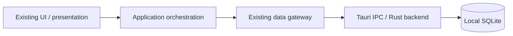
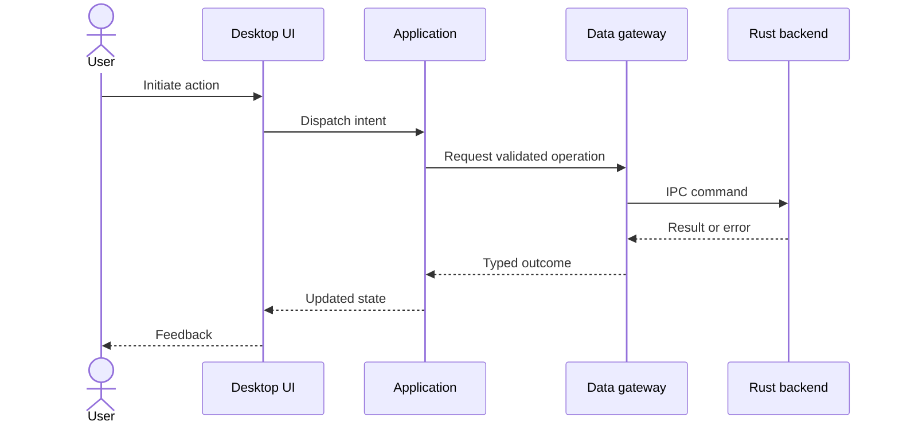

# Design First: System Design and Approval Gate

> Canonical workflow supplement. Architecture authority remains in [architecture.md](../architecture.md), [domain-architecture.md](../domain-architecture.md), relevant ADRs, and [CODE_QUALITY.md](CODE_QUALITY.md). This document does not replace their dependency, naming, or size rules.

## Mandatory stop before implementation

For every new feature, integration, material refactor, schema migration, new domain concept or bounded context, public API or IPC contract change, and security/privacy-sensitive change:

1. Run task triage and inspect current branch, code, docs, relevant ADRs and open work. Read `AGENTS.md`, `docs/internal/AGENT_START_HERE.md`, architecture/domain canon, quality rules, validation matrix, current state and the smallest relevant specifications.
2. Prepare a **design-only proposal** with the appropriate diagrams and decisions below. Mark current behavior versus proposed behavior; do not present speculative modules as existing.
3. Request architecture review and **explicit user approval**. **STOP: do not write production code, migrations or tests implementing the change before approval.** A design-only PR is preferred for substantial changes.
4. After approval, implement only the approved scope, in a separate implementation PR for substantial changes. Link the approved design/issue in that PR.
5. Verify implementation against diagrams, contracts, DDD language, dependency rules, security/privacy and test plan. Document deviations. Material deviations require a new review and approval before proceeding.

A prior conversation, a task assignment, an AI-generated plan, or silence is **not** approval. Approval must identify the design/revision. If approval is missing, deliver the design and stop.

## Minimum design proposal

- **Problem and scope:** user outcome, assumptions, non-goals, acceptance criteria, existing behavior and affected files/modules.
- **Context and boundaries:** desktop versus web, existing Nx projects, logical DDD bounded contexts, layer ownership and dependency direction; reuse existing names and abstractions.
- **Visual design:** diagrams as Mermaid in Markdown, reflecting real repository boundaries. Use a context/component diagram and a sequence diagram for multi-component changes; add data-flow, state, deployment or migration diagrams when relevant. Explain trust boundaries and local/external data movement.
- **Contracts and data:** TypeScript/Rust interfaces, Tauri IPC or API inputs/outputs, validation, persistence ownership, migration and backward compatibility as applicable.
- **Operational behavior:** error states, retries, recovery/rollback, performance and observability without introducing desktop telemetry.
- **Security and privacy:** data classification, secrets, permissions, user consent and explicit external-provider calls. Preserve desktop local-first and no automatic submissions.
- **Alternatives and trade-offs:** reuse versus new abstraction, complexity, risks and rejected options.
- **Verification:** unit/integration/E2E coverage, negative cases, applicable validation commands, acceptance checks and rollout.
- **Approval record:** link to design PR or document revision, reviewer decision, date, open questions, and implementation PR link once created.

Do not require every diagram or section for an irrelevant concern. Explain omissions briefly; do not invent services, endpoints, domain objects or future features.

## Reference diagram templates

Replace placeholders with actual module names, observed dependencies and validated contracts.

These are illustrative, not a claim that every Applye workflow follows these exact calls. Confirm actual flow in source before copying.

## Lightweight exception

Typo-only, formatting-only, and other triaged simple changes that do not alter behavior, contracts, domain language, persistence or boundaries may use a brief impact statement instead of a full design. A bug fix with cross-layer impact, security/privacy implications or architectural change is **not** exempt. When uncertain, prepare the design.

## Pull request checklist

- [ ] Relevant canonical documents and existing implementation inspected
- [ ] Task classified and design depth justified
- [ ] Diagrams and interfaces match actual architecture
- [ ] Domain naming and Nx dependency constraints checked
- [ ] Privacy/security, failures, migrations and testing addressed where applicable
- [ ] Explicit user approval recorded **before** implementation
- [ ] Implementation PR references approved design and explains any approved deviations
